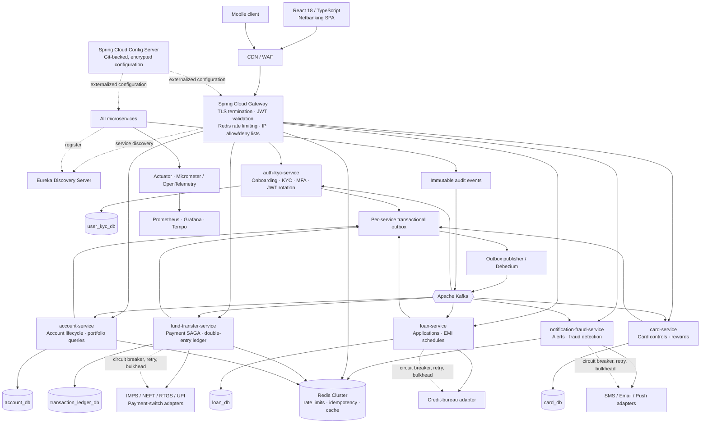

# Core Banking Platform — Phase 1 Architecture

## System context



## Fund-transfer SAGA and consistency boundary

```mermaid
sequenceDiagram
    participant C as Client
    participant G as API Gateway
    participant F as Fund Transfer Service
    participant A as Account Service
    participant L as Ledger DB
    participant K as Kafka
    participant N as Notification/Fraud

    C->>G: POST /transfers + Idempotency-Key
    G->>F: Authenticated request
    F->>F: Atomically claim idempotency key
    F->>A: Validate accounts, status and balance
    A-->>F: Funds available
    F->>L: Commit transfer + balanced debit/credit entries + outbox
    Note over L: One local ACID transaction\nSUM(debits) = SUM(credits)
    F->>K: Publish TransferPosted from outbox
    K-->>A: Apply balance projection / cache invalidation
    K-->>N: Send alert and evaluate fraud rules
    F-->>C: 201 Created / replay stored result
    alt downstream failure before posting
        F->>F: Mark failed; issue compensating event if needed
    end
```

### Design invariants

- A service writes only its database. Cross-service state changes are events, never cross-database joins.
- Every money-moving command has a client-provided idempotency key and returns the first committed response on replay.
- Ledger journal entries are append-only and are posted in a single database transaction with an outbox event.
- Account statements are CQRS read projections; the ledger remains the financial system of record.
- Security, KYC, access and balance-change events are immutably published to Kafka.

## Database scripts

| Service database | DDL |
| --- | --- |
| Identity, access and KYC | [user_kyc_db.sql](../../database/ddl/user_kyc_db.sql) |
| Accounts and portfolio | [account_db.sql](../../database/ddl/account_db.sql) |
| Transfers and ledger | [transaction_ledger_db.sql](../../database/ddl/transaction_ledger_db.sql) |
| Loans | [loan_db.sql](../../database/ddl/loan_db.sql) |
| Cards | [card_db.sql](../../database/ddl/card_db.sql) |

## Planned repository layout

```text
e-banking-platform/
├── platform/
│   ├── config-server/
│   ├── discovery-server/
│   └── api-gateway/
├── services/
│   ├── auth-kyc-service/
│   │   └── src/{main,test}/java/com/ebanking/authkyc/
│   ├── account-service/
│   │   └── src/{main,test}/java/com/ebanking/account/
│   ├── fund-transfer-service/
│   │   └── src/{main,test}/java/com/ebanking/transfer/
│   ├── loan-service/
│   │   └── src/{main,test}/java/com/ebanking/loan/
│   ├── card-service/
│   │   └── src/{main,test}/java/com/ebanking/card/
│   └── notification-fraud-service/
│       └── src/{main,test}/java/com/ebanking/notificationfraud/
├── database/ddl/
├── docs/phase-1/
├── docker/
├── gradle/
├── build.gradle
└── settings.gradle

e-banking-web/
├── src/
│   ├── app/{router,store,providers}/
│   ├── features/{auth,accounts,transfers,cards,loans,notifications}/
│   ├── components/{ui,layout,shared}/
│   ├── lib/{api,websocket,security}/
│   ├── schemas/
│   ├── hooks/
│   └── types/
├── public/
├── tests/{unit,e2e}/
├── package.json
├── tsconfig.json
├── tailwind.config.ts
└── vite.config.ts
```
